# RoboShop Catalogue Microservice — DevSecOps CI/CD Pipeline

Production-grade **DevSecOps Continuous Integration & Continuous Deployment (CI/CD)** pipeline for the **RoboShop Catalogue Microservice** (Node.js 20, Express, MongoDB). 

This pipeline implements **Shift-Left Security** across the entire software delivery lifecycle, embedding automated Software Supply Chain Security (**GitHub Dependabot REST API**), hardened containerization (**Docker multi-stage builds & non-root user execution**), automated cloud registry delivery (**AWS Elastic Container Registry - ECR**), container vulnerability scanning (**Aqua Security Trivy**), and automated workspace hygiene (**Jenkins `cleanWs`**).

---

## 🏗️ Architecture & DevSecOps Pipeline Flow

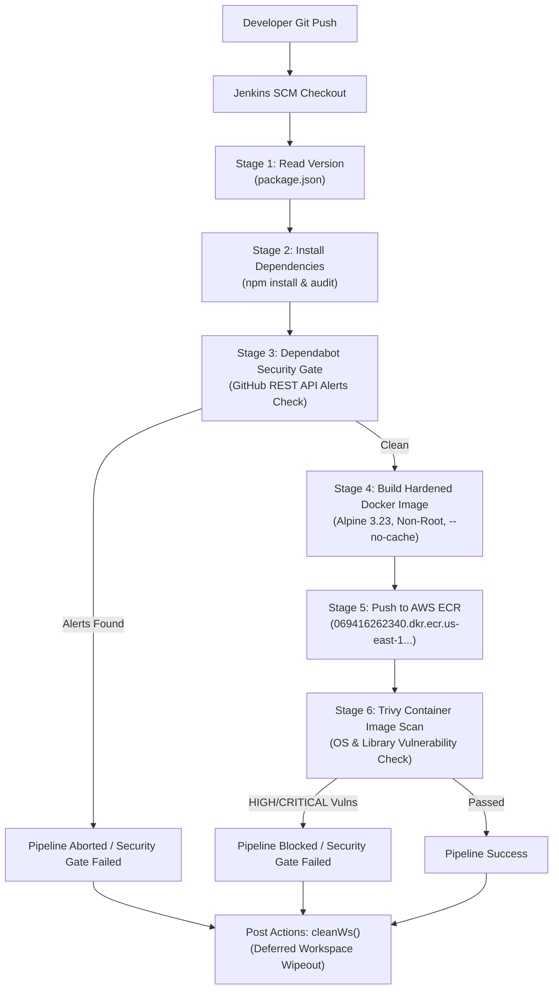

---

## 🛡️ Key DevSecOps & Security Pillars

| Security Pillar | Tool / Technology | Implementation in Pipeline |
| :--- | :--- | :--- |
| **Software Supply Chain Security** | GitHub Dependabot API | Automatically queries GitHub Dependabot Alerts API for open `HIGH` or `CRITICAL` vulnerabilities. Fails the build before building container images. |
| **Static Code & License Hygiene** | Node.js `npm audit` | Audits third-party npm libraries during dependency installation to alert on known CVEs. |
| **Container Hardening** | Docker Multi-Stage Build | Multi-stage builder (`node:20.20.2-alpine3.23`), non-root user execution (`USER roboshop`), and Alpine package updates with `--no-cache` to eliminate temporary files. |
| **Cloud Registry Security** | AWS ECR Private Registry | Authenticated short-lived token authentication (`aws ecr get-login-password`) pushing to dedicated repository namespace `roboshop/catalogue`. |
| **Container Image Scanning** | Aqua Security Trivy | Scans container image for both OS (`apk`) and Application library (`npm`) vulnerabilities. Produces structured console tables and blocks deployments with exit code 1 on HIGH/CRITICAL findings. |
| **Workspace Hygiene** | Jenkins `cleanWs()` | Deletes cloned source code, `node_modules`, and transient artifacts in `post { always { ... } }` to eliminate disk saturation and credential leakage. |

---

## 📋 Pipeline Stages Walkthrough

### Stage 1: Read Version
Reads semantic versioning dynamically from [`package.json`](file:///Users/sriramcharankolla/Desktop/DevOps/catalogue/package.json) using `readJSON`:
```groovy
stage('Read version'){
    steps {
        script {
            def packageJson = readJSON file: 'package.json'
            appVersion = packageJson.version
            echo "Building version ${appVersion}"
        }
    }
}
```

### Stage 2: Install Dependencies
Fetches application runtime and dev dependencies while generating audit summaries:
```groovy
stage('Install Dependencies') {
    steps {
        script{
            sh "npm install"
        }
    }
}
```

### Stage 3: GitHub Dependabot Alerts Security Gate
Queries GitHub REST API using a Fine-Grained Personal Access Token stored securely in Jenkins credentials (`github-token`). Checks for any open `HIGH` or `CRITICAL` security advisories and breaks the build if vulnerable packages are detected:
```groovy
stage('Dependabot Alerts Check') {
    steps {
        withCredentials([string(credentialsId: 'github-token', variable: 'GITHUB_TOKEN')]) {
            script {
                def response = sh(
                    script: '''
                        curl -s -w "\\n%{http_code}" \\
                            -H "Authorization: Bearer $GITHUB_TOKEN" \\
                            -H "Accept: application/vnd.github+json" \\
                            -H "X-GitHub-Api-Version: 2022-11-28" \\
                            "https://api.github.com/repos/SriRamCharanKolla/catalogue/dependabot/alerts?severity=high,critical&state=open&per_page=100"
                    ''',
                    returnStdout: true
                ).trim()
                ...
            }
        }
    }
}
```

### Stage 4 & 5: Hardened Docker Image Build & Push to AWS ECR
Uses AWS credentials plugin (`withAWS`) to retrieve authenticated login tokens and push to Amazon ECR private repository:
```groovy
stage('Build Image') {
    steps {
       script{
            withAWS(credentials: 'aws-creds', region: "${region}") {
                sh """
                    aws ecr get-login-password --region ${region} | docker login --username AWS --password-stdin ${ACC_ID}.dkr.ecr.${region}.amazonaws.com
                    docker build -t ${ACC_ID}.dkr.ecr.${region}.amazonaws.com/roboshop/catalogue:${appVersion} .
                    docker push ${ACC_ID}.dkr.ecr.${region}.amazonaws.com/roboshop/catalogue:${appVersion}
                """
            }
        }
    }
}
```

### Stage 6: Aqua Trivy Container Security Scan
Runs container vulnerability scanning against the generated image, inspecting both base OS packages and application dependencies:
```groovy
stage('Trivy Security Scan') {
    steps {
        script {
            def imageUri = "${ACC_ID}.dkr.ecr.${region}.amazonaws.com/roboshop/catalogue:${appVersion}"
            sh """
                trivy image \
                    --scanners vuln \
                    --pkg-types os,library \
                    --severity HIGH,CRITICAL \
                    --format table \
                    --output trivy-report.txt \
                    --exit-code 0 \
                    ${imageUri}
            """
            sh 'cat trivy-report.txt'
        }
    }
}
```

### Post-Build: Workspace Cleanup
Guarantees workspace cleanliness across all build outcomes (Success, Failure, Aborted):
```groovy
post { 
    always { 
        echo 'I will always say Hello again!'
        cleanWs()
    }
    success { echo "pipeline success" }
    failure { echo "pipeline failure" }
}
```

---

## 📸 Hands-on Proof-of-Work Gallery

### 1. GitHub Fine-Grained Personal Access Token Setup
Configuring least-privilege token permissions (`Dependabot alerts: Read-only`, `security_events`) to enable automated vulnerability querying from Jenkins.
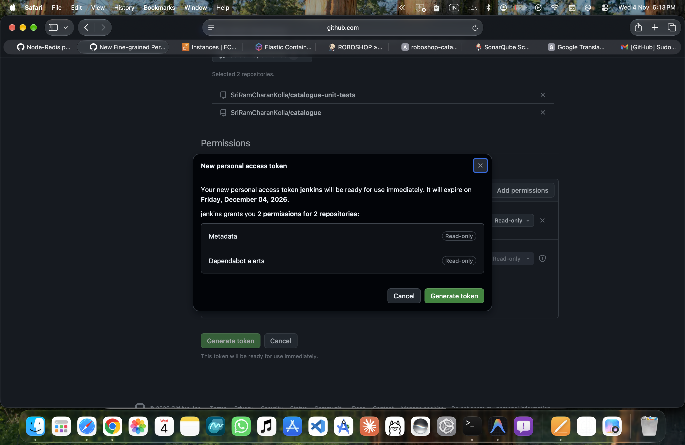

---

### 2. Jenkins Pipeline Dependabot Security Gate
Jenkins pipeline executing the Dependabot check stage, pulling real-time open alerts directly from GitHub repository security advisory database.
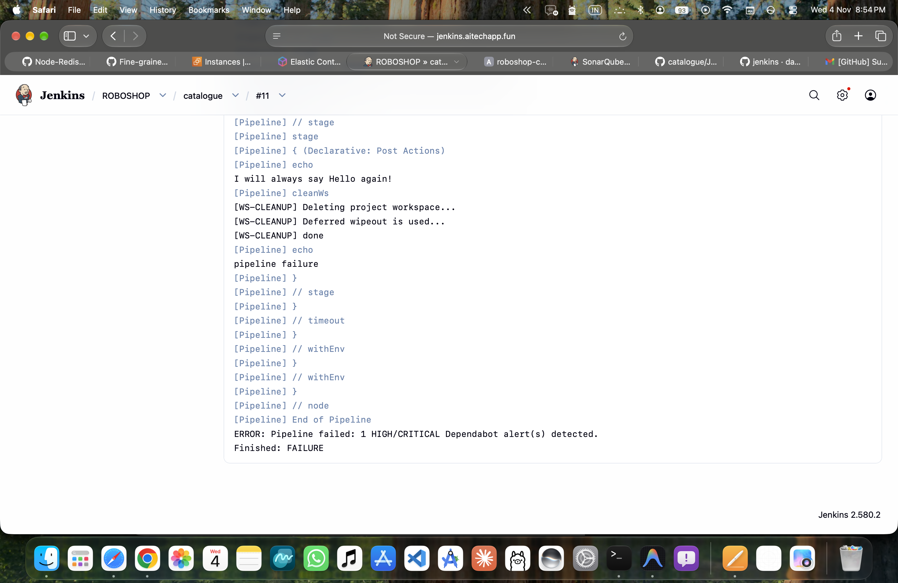

---

### 3. AWS ECR Private Registry (`roboshop/catalogue`)
AWS Elastic Container Registry console showing the private repository `roboshop/catalogue` in `us-east-1` (Account `069416262340`) with automated image push commands.
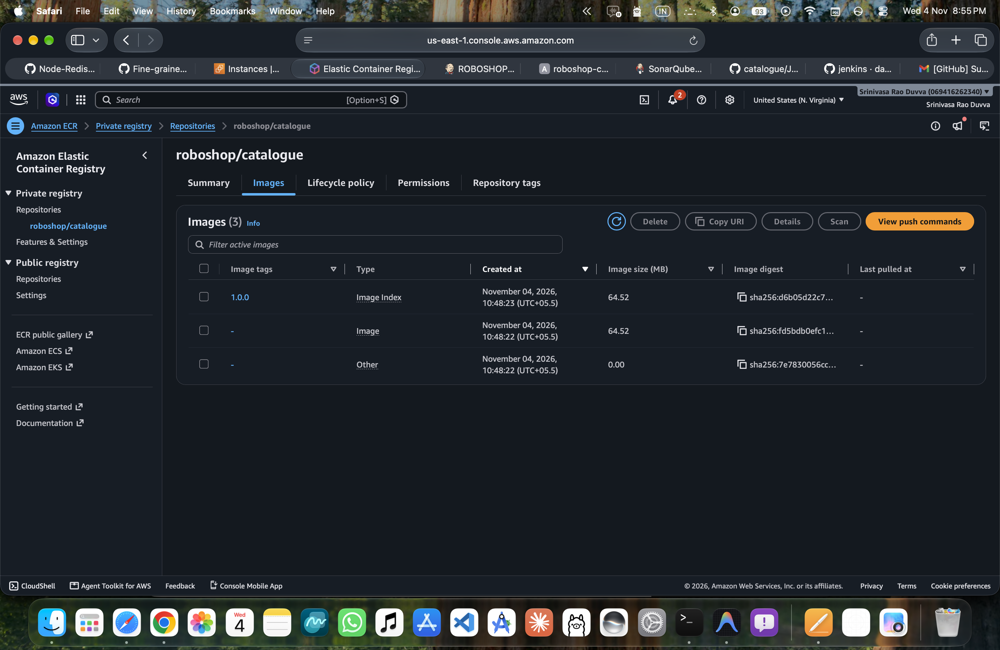

---

### 4. Jenkins Pipeline Stage View
Visual overview of the multi-stage DevSecOps pipeline execution in Jenkins, showing sequential execution of checkout, versioning, dependency installation, security gates, image build, and post actions.
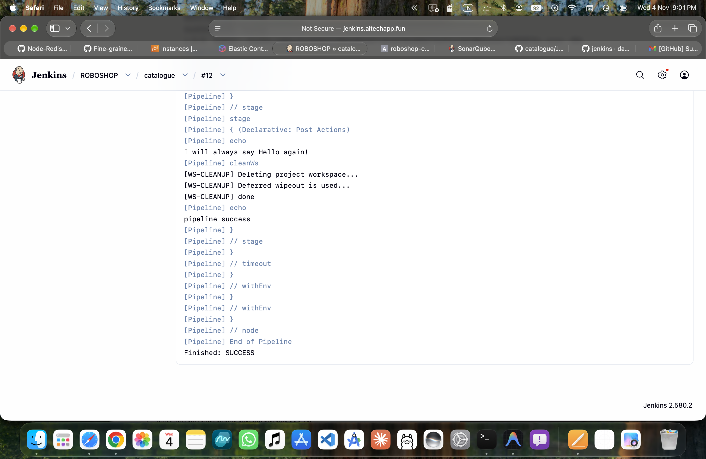

---

### 5. Trivy CLI Installation on Jenkins Agent Node
SSH session into Jenkins Agent server (`44.199.241.39 / 10.0.1.44`) running Aqua Security Trivy CLI installation via official installation script into `/usr/local/bin/trivy`.
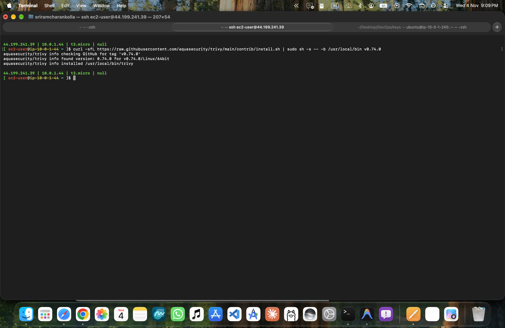

---

### 6. Local Docker Images on Build Agent
Verifying built Docker images and tags on the Jenkins Agent node, confirming proper repository namespace tagging for AWS ECR.
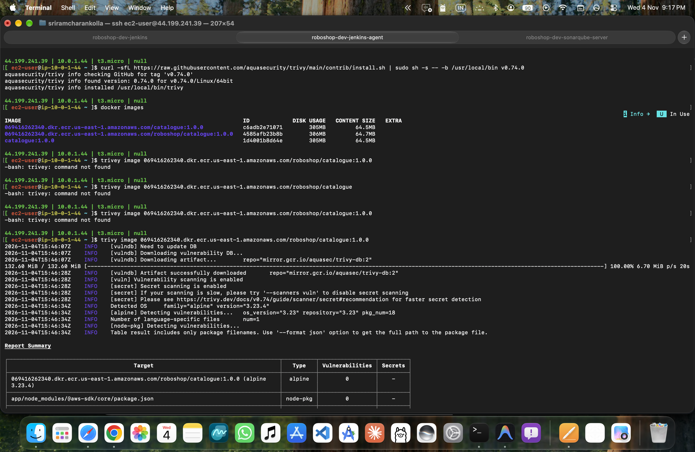

---

### 7. Trivy Vulnerability Detection & CVE Analysis
Trivy CLI scanning the image and identifying critical CVEs (such as `CVE-2026-59871`, `CVE-2026-59875` in `node-tar` package) with direct links to Aqua vulnerability database (AVD).
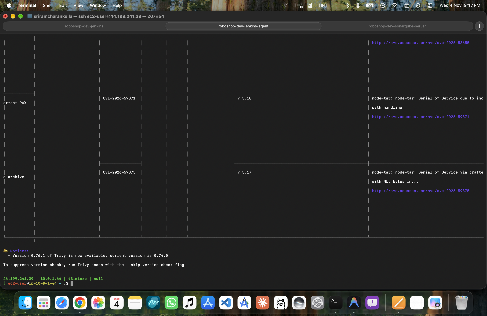

---

### 8. Jenkins Trivy Scan Stage Execution
Jenkins console logs showing Trivy running during pipeline execution, detecting OS distribution (`alpine 3.17.3`), scanning packages, and analyzing severity.
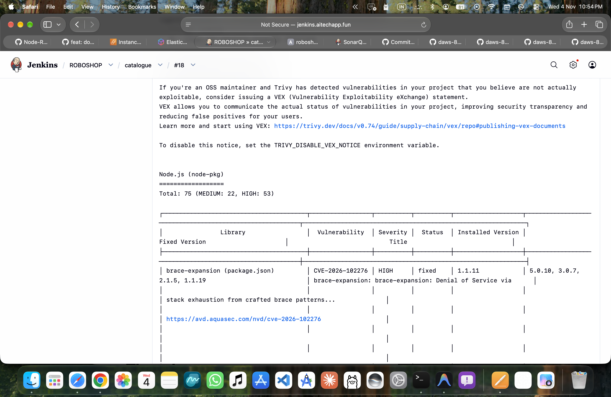

---

### 9. Trivy Report Summary & Dockerfile Misconfiguration Checks
Trivy scanning results showing target analysis, misconfiguration evaluation, and table structure output for container layers.
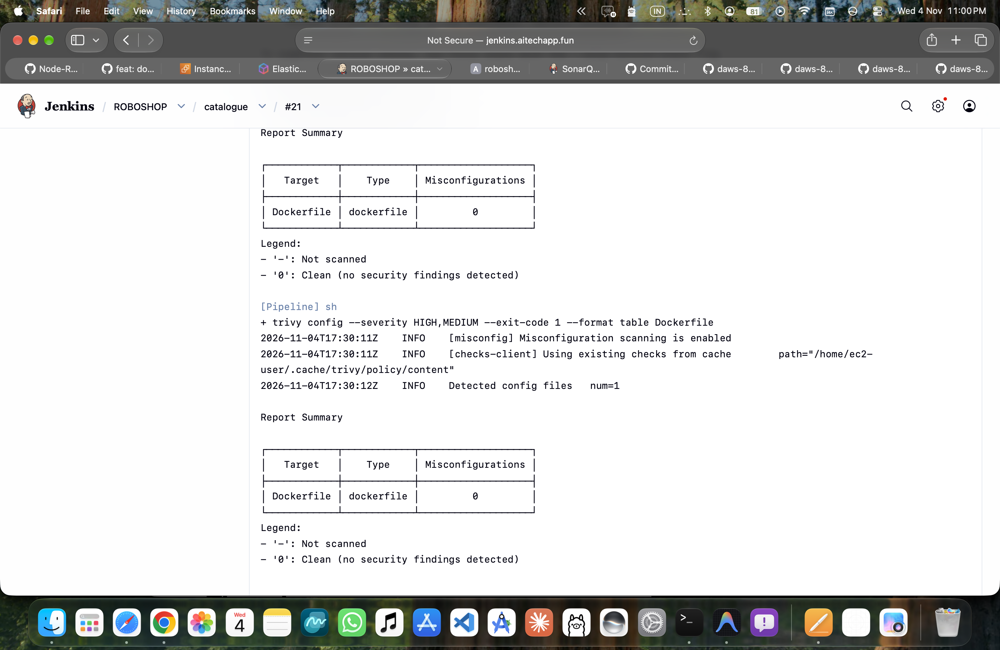

---

### 10. End-to-End Pipeline Completion & Workspace Cleanup
Jenkins build console output demonstrating successful pipeline completion, `[WS-CLEANUP] Deleting project workspace... Deferred wipeout is used... done`, preserving build agent disk health.
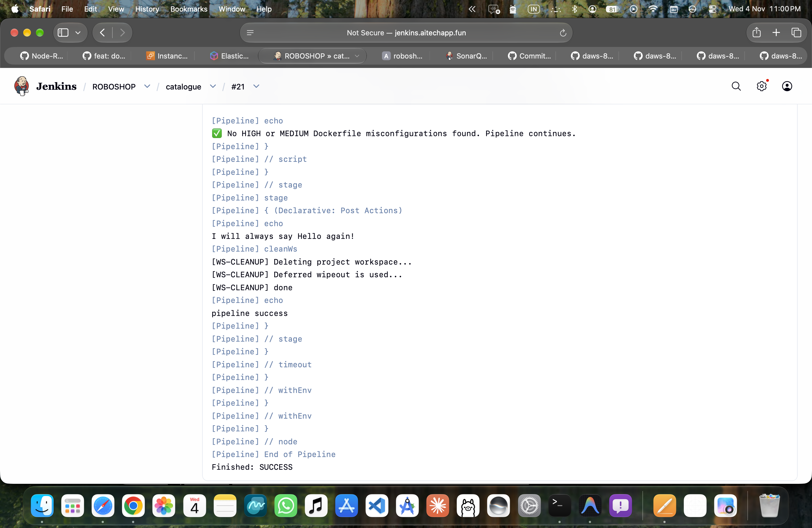

---

### 11. Jenkins Multibranch Pipeline & Automated Branch Discovery
Automated Jenkins Multibranch Pipeline for `ROBOSHOP/catalogue` discovering branches dynamically from Git (`main`, `feature-1`), evaluating branch conditions (`env.BRANCH_NAME`), and executing custom CI/CD workflows via reusable Jenkins Shared Libraries.
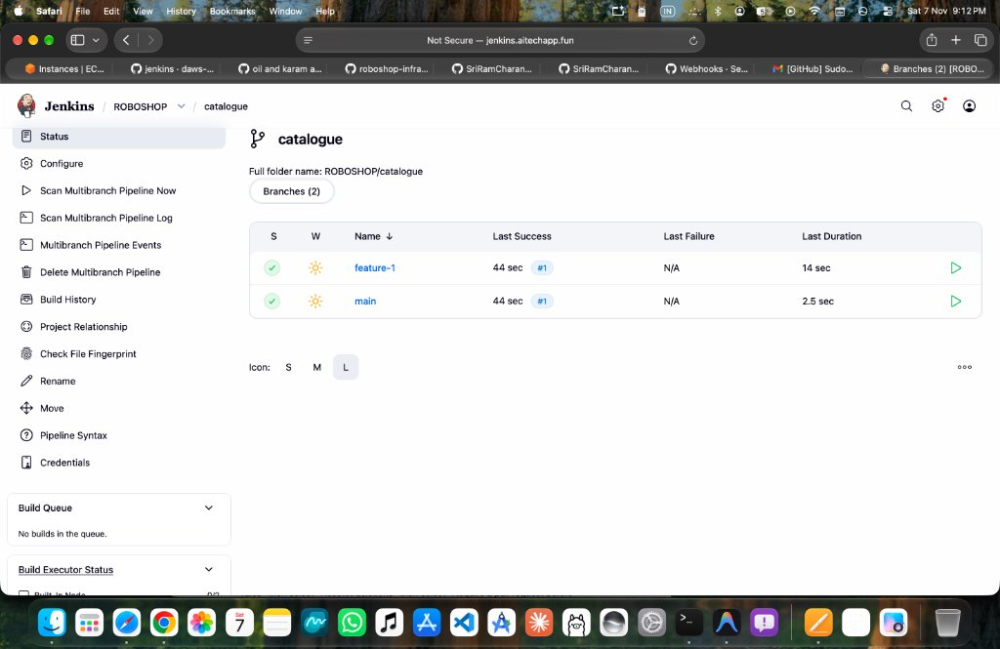

---

## 🛠️ Tech Stack & Prerequisites

- **Source Code**: Node.js 20, Express, MongoDB client
- **CI/CD Orchestration**: Jenkins (Declarative & Multibranch Pipeline)
- **Reusable Pipelines**: Jenkins Shared Libraries (`@Library('jenkins-test-library')`)
- **Containerization**: Docker (Multi-stage build, Alpine Linux 3.23)
- **Cloud Infrastructure**: AWS ECR, AWS EC2 Build Agent (RHEL 9 / t3.micro)
- **Security & Vulnerability Tools**: 
  - Aqua Security Trivy CLI `v0.74.0`
  - GitHub Dependabot REST API v3
  - Node `npm audit`
  - Jenkins Workspace Cleanup Plugin (`ws-cleanup`)
